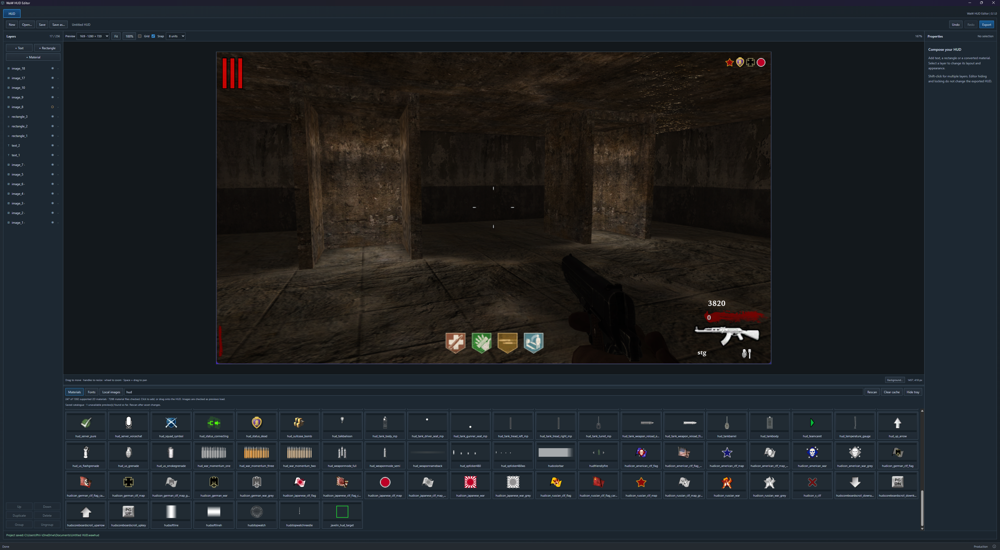

# WaW HUD Editor

**An unofficial community app. Not affiliated with Treyarch, Activision or UGX.**

Design static World at War HUDs without writing `.inc` code. Place text, rectangles and images, then export the code or prepare your mod. Made by [phil81334](https://github.com/phil81334). Built with JavaScript, Rust, Vite and Tauri.



More screenshots: [In-game result](images/waw-hud-editor-in-game.png) · [Local images](images/waw-hud-editor-local-images.png)

## Download and run

1. Have World at War and its Modtools installed in the same game folder.
2. Open [Releases](https://github.com/phil81334/waw-hud-editor/releases/latest). Under **Assets**, download **waw-hud-editor.exe**. The source-code ZIP is for development.
3. Put the EXE beside `CoDWaW.exe`, then double-click it.

No development tools needed. Windows needs [WebView2](https://developer.microsoft.com/microsoft-edge/webview2/#download-section), usually already installed; if missing, install its **Evergreen Bootstrapper**.

## Make a HUD

- Add text or rectangles, or click/drag thumbnails from **Materials**, **Fonts** and **Local images** onto the canvas.
- Drag to move, use handles to resize, and change exact values in Properties. Grid/snap sizes range from 1–64 HUD units. Wheel zooms; Space + drag pans. Drag layers to reorder; double-click to rename. Undo/redo is included.
- **Background…** adds an editor-only screenshot reference. **Save** keeps your editable `.wawhud` project.
- Local PNG/JPG/WebP/BMP/TGA images work before conversion. Projects save links, so keep those files in place. For game use, convert them into **2D materials** in Asset Manager. In **Materials**, click **Rescan**, select the existing local-image layer, click **Assign converted material…**, then click its material thumbnail. Position and size are kept.

**Export** provides independent options:

- **HUD code:** copy the code or save an `.inc` for your own HUD setup.
- **Images:** copy converted images into your mod and select them for Launcher's IWD build.
- **HUD setup:** prepare the `.inc`, its HUD include and `mod.csv` entries for a compatible mod.

Mod changes are reviewed first, with numbered backups of changed files. Close Launcher before applying them, then reopen it. Build **mod.ff** after HUD setup and the **IWD** after copying images. Test in-game yourself; the editor does not build or launch the game.

Existing custom HUDs may need manual integration: use **HUD code** and **Images** separately. Unconverted local-image layers block code/setup export until assigned converted materials. Screenshot backgrounds never export.

This creates **static .inc HUD elements**. No GSC-driven counters, menu editing or asset conversion. The preview helps with composition and positioning; it does not reproduce every in-game material effect. Unsupported converted materials/previews are left out. Stock fonts use the installed game assets; some fonts share glyphs.

The first scan saves a small metadata catalogue in `%LOCALAPPDATA%\WaW HUD Editor\cache`. Later launches reuse it; image pixels are not saved there. Use **Rescan** after asset changes. **Clear cache** deletes that catalogue and empties Materials/Fonts without changing your HUD. Local images have their own **Refresh** button.

## Run from source

**Windows setup — do this once.** Skip anything already installed.

| Install | What to choose |
| --- | --- |
| [VS Code](https://code.visualstudio.com/) | The Windows installer. Open the project here. |
| [Node.js](https://nodejs.org/en/download) | **LTS**, **Windows**, **Installer (.msi)**. Keep defaults; npm is included. |
| [Microsoft C++ Build Tools](https://visualstudio.microsoft.com/visual-cpp-build-tools/) | Select **Desktop development with C++**. Keep its MSVC tools and Windows SDK. |
| [Rust](https://rust-lang.org/tools/install/) | Run **rustup-init.exe (x64)** and choose the default installation. |

Reopen VS Code afterwards. [Tauri's Windows guide](https://v2.tauri.app/start/prerequisites/#windows) has more help. The project installs Vite and Tauri; no Python is needed.

1. Choose **Code → Download ZIP** on GitHub and extract it, or clone the repo.
2. In VS Code, choose **File → Open Folder** and open the folder containing `package.json`.
3. Create a folder named `.local`, then a file inside it named `game-path.txt`.
4. In File Explorer, open your game folder containing `CoDWaW.exe`. Copy its full address into `game-path.txt` and save: one line, no quotes, no EXE filename. Use your own drive/folder.
5. Choose **Terminal → New Terminal** and run these one at a time:

   ```powershell
   npm install
   npm run dev
   ```

The first command installs dependencies; the second opens the desktop app. The first Rust build takes longer. Keep the terminal open; **Ctrl+C** stops development.

Next time, run `npm run dev` or click **dev**'s play button in VS Code's **NPM Scripts** panel. If hidden, right-click the Explorer panel headings and enable **NPM Scripts**. Update `game-path.txt` if you move WaW. The packaged EXE always uses its own folder.

| Command | What it does |
| --- | --- |
| `npm run dev` | Opens the desktop app for development. |
| `npm run dev:web` | Previews the UI in a browser; no installed fonts/materials or native file dialogs. |
| `npm run build` | Creates `release/waw-hud-editor.exe`. |
| `npm run build:web` | Builds the UI files only. No EXE. |

Put your built EXE beside `CoDWaW.exe` to use it.

[Credits](ATTRIBUTION.md) · [GPL-3.0 licence](LICENCE)
